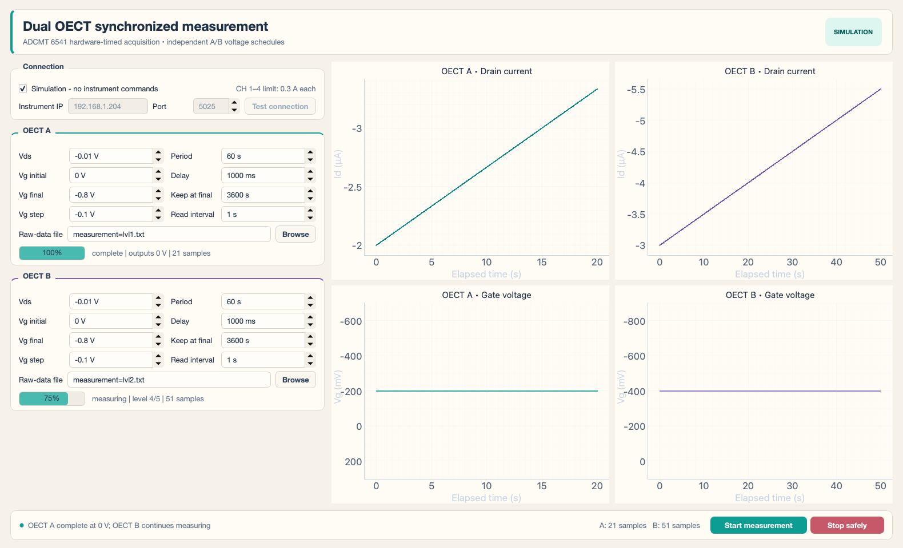

# ADCMT 6541 synchronized two-OECT measurement

## Recommendation

Do not try to make four LabVIEW `Read (Single Point)` calls run in parallel. One VISA/TCP session and the existing error-wire dataflow serialize those calls, and parallel host calls still would not define a common measurement instant.

Use the 6541's internal channel synchronization and per-channel measurement memory. CH1 generates a 1.000 s timer and internal SYNC pulse; CH2-CH4 measure from that pulse. The manual specifies approximately 5 us synchronization delay, which is compensated by using a 55 us measurement delay on CH1 and 50 us on the slaves.

This folder contains:

- `oect_dual_gui.py`: polished desktop front panel with independent OECT A/B schedules and four live plots.
- `launch_gui.command`: double-clickable macOS launcher for the GUI.
- `adcmt_6541_sync.py`: complete standard-library Python controller/logger.
- `config.example.json`: the requested -0.1 V through -0.8 V, 3600 samples per step example.
- `LABVIEW_PATCH_GUIDE.md`: exact LabVIEW architecture and ADCMT command sequence.
- `requirements.txt`: PyQt5, pyqtgraph, and NumPy dependencies for the GUI; the CLI controller uses only the standard library.
- `test_synthetic.py`: offline tests using generated values only; it never opens experiment data.
- `test_gui_synthetic.py`: verifies scheduling helpers and byte-for-byte historical text formatting.

## Recommended GUI

Double-click `launch_gui.command`, or run:

```bash
/usr/bin/python3 oect_dual_gui.py
```



The warm, cream-colored GUI starts in simulation mode so it cannot energize the instrument accidentally. OECT A and B have independent Vds, Vg initial/final/step, per-level hold, extra final keep, pre-measurement delay, output interval, and output filenames. Both control cards stay visible in a left column without scrolling. Each card orders its left controls as Vds, Vg initial, Vg final, Vg step; its right controls as period, delay, keep at final, read interval. The four larger, nearly square live plots put elapsed time horizontally and Id or Vg vertically, with the vertical axis inverted so more-negative values appear higher. Numeric controls omit unnecessary trailing zeros, and the spin-box arrows are dark for visibility; raw-data numeric formatting is unchanged.

The current-limit controls are hidden. The GUI fixes drain and gate current limits on CH1–CH4 at **0.3 A each** and confirms that setting before a live run.

The delay is *inside* each hold period: the gate changes at the start of the period, logging begins after the delay, and the next gate step starts when the hold period ends. The final keep time extends the last period.

The instrument keeps acquiring synchronized samples during a delay, but those samples are deliberately omitted from that cell's file and live plot. This allows A and B to use different delays without breaking their common hardware sampling clock.

When one OECT finishes before the other, its drain and gate source settings are each changed to 0 V and verified. Its file and live plots stop receiving samples, and its progress reaches 100%. The other OECT continues on its own schedule. If A finishes first, CH1 remains in operate mode at 0 V solely to keep the shared hardware trigger running for B; the final cleanup puts the instrument in standby. These source changes are sent from the computer at the scheduled boundary, so their physical timing has normal command/network latency rather than a guaranteed zero-latency transition.

When A and B use different output intervals, the 6541 runs all four channels from a common millisecond-resolution hardware clock (the greatest common divisor of the two intervals). Each text file is decimated to its requested interval; samples that appear in both files still come from the same hardware trigger.
The common interval must be at least 0.100 s; the GUI reports incompatible interval choices before starting.

Each OECT gets its own historical-format file:

```text
Time<TAB>GateI<TAB>GateV<TAB>DrainI<TAB>DrainV
```

Numbers use seven digits after the decimal and LabVIEW-style exponents such as `1.0380000E+0`. The GUI defaults to `../measurement=lvl1.txt` and `../measurement=lvl2.txt` in the `ADCMT IV` mother folder. Existing raw files are never read or appended; a new run asks before replacing an existing output.
`GateI` and `DrainI` are measured currents. `GateV` and `DrainV` are the verified/configured source-voltage values, not additional simultaneous voltage ADC readings.

This was checked against historical files under `../26.09.04/` and `../26.08.04/`. Their five columns and numeric layout are reproduced; the timestamp values in new files come from the synchronized sample clock instead of the former sequential host reads.

The GUI defaults were obtained from a full export of `../YZ_Stair case 2sim lvl_26.09.15.vi`: Vds -0.01 V, Vg 0 to -0.8 V in -0.1 V steps, 60 s period, 3600 s final keep, 1000 ms delay, 1 s interval, and 0.3 A drain/gate limits. Both OECT panels start with these voltage/timing values, then can be edited independently; current limits remain fixed.

**Measurement-range caution:** the synchronized program uses fixed current measurement ranges (`R1`) tied to each channel's current limit. The inherited 0.3 A limits may both be unsafe and too coarse to resolve nanoampere currents. Verify them on a dummy load before a live run; to use a lower GUI limit, change `DEFAULT_CURRENT_LIMIT_A` in `oect_dual_gui.py`, or use the CLI's configurable limits. The GUI warns before every live run.

Python is not inherently more synchronous than LabVIEW; the 6541 hardware timing is what fixes the problem. Python is attractive here because a long-running state machine, batched CSV logging, error handling, and version control are simpler. If the current LabVIEW front panel is important, patching it according to the guide is equally valid.

## Before the first real run

1. Make a short test with a resistor/dummy load.
2. Edit `config.example.json` and set safe per-channel current limits. The included 0.3 A values only preserve the original VI's displayed defaults and may be inappropriate for an OECT.
3. Confirm the 6541 LAN address and that its interface is set to LAN.
4. Confirm channel wiring:
   - CH1: OECT A drain
   - CH2: OECT A gate
   - CH3: OECT B drain
   - CH4: OECT B gate
5. Confirm polarity before enabling outputs.

## Dry run

This validates the JSON and prints the full command plan without opening a socket or enabling an output:

```bash
python3 adcmt_6541_sync.py --config config.example.json
```

## Real run

Only add `--execute` after reviewing the dry-run plan and the limits:

```bash
python3 adcmt_6541_sync.py --config config.example.json --execute
```

The CSV is written beside the configuration file. Press Ctrl-C once for a controlled stop; the program pauses triggering and sets the synchronized outputs to Standby in cleanup.

## Offline synthetic tests

These tests do not connect to the 6541 and do not read any experiment data:

```bash
python3 -m unittest -v test_synthetic.py test_gui_synthetic.py
```

## CSV interpretation

Each row contains one common hardware sample index and the four simultaneous current measurements:

- `id_a_a`: CH1 drain current
- `ig_a_a`: CH2 gate current
- `id_b_a`: CH3 drain current
- `ig_b_a`: CH4 gate current

The voltage columns are verified source setpoints, not four additional ADC conversions. A 6541 channel configured as a voltage source normally measures current; it does not independently digitize both voltage and current at the same instant. `nominal_elapsed_s` comes from the hardware sample index and programmed period. Step-start UTC is host time because the 6541 has no measurement timestamp output.

## Why batch reads remove the lag

The instrument takes samples every 1.000 s regardless of when the computer reads them. The program fetches older memory addresses in 60-sample batches and aligns channels by address. Network transfer can momentarily take tens or hundreds of milliseconds without lengthening the sampling interval. With 3600 samples per one-hour step, the 10,000-point per-channel memory is sufficient.

## Limitations

- The instrument specification says approximately 5 us synchronization delay, not zero.
- The code has been syntax- and dry-run-tested without energizing the attached instrument. Perform a short dummy-load validation before an eight-hour experiment.
- If `RDT?` is rejected while memory storage is active on your firmware revision, set `batch_samples` to 3600 and fetch after each step; sampling remains hardware timed, but step transitions will include the LAN transfer time.
